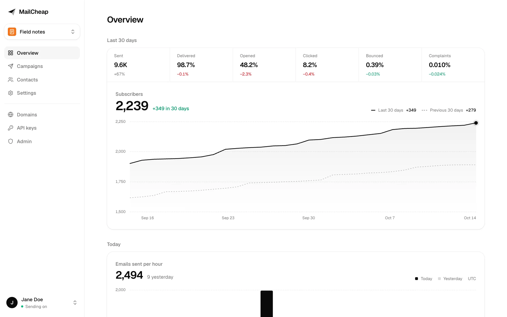
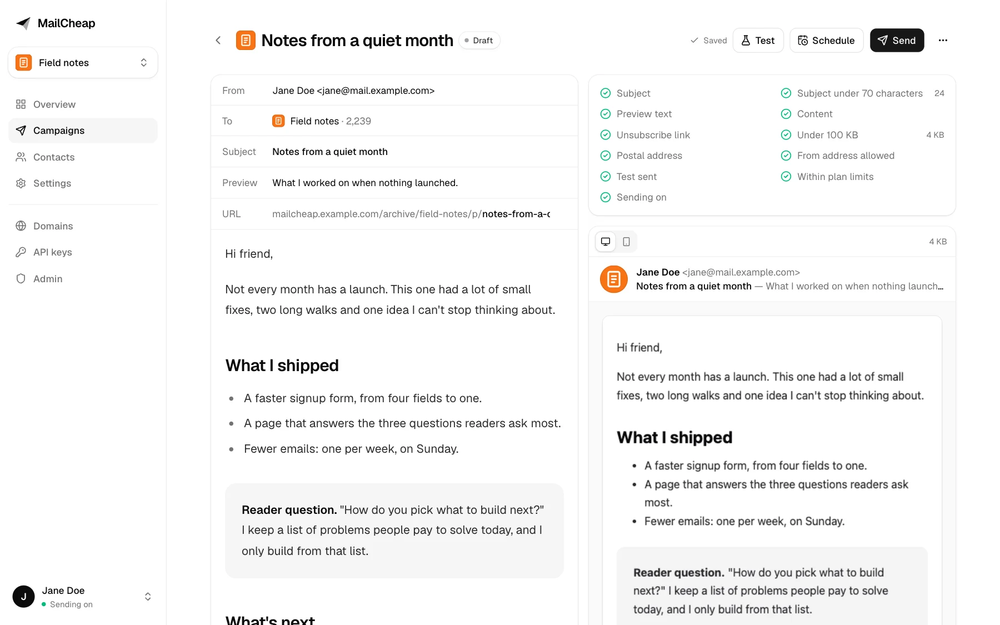
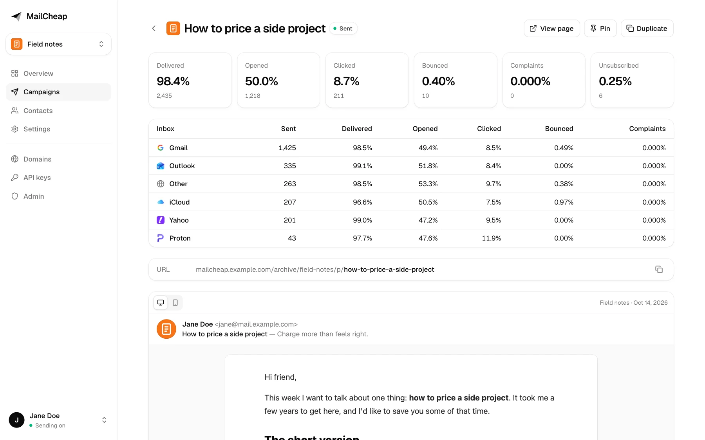
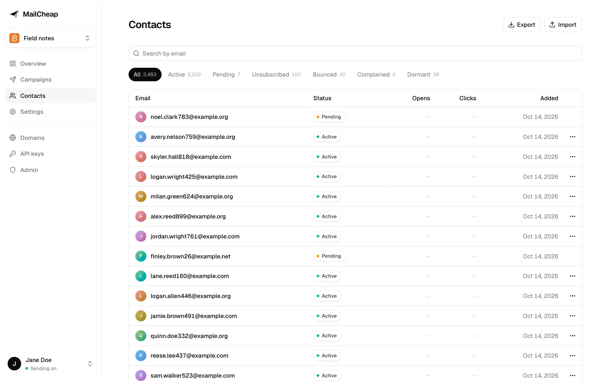
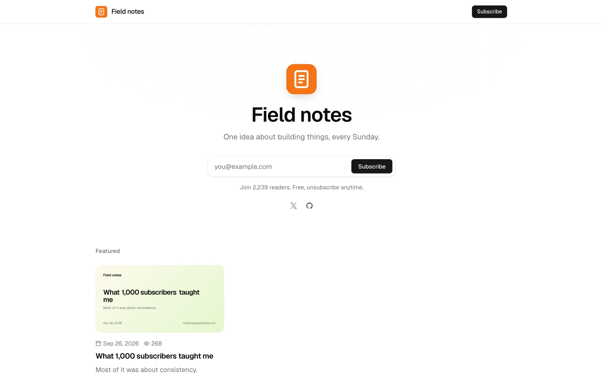
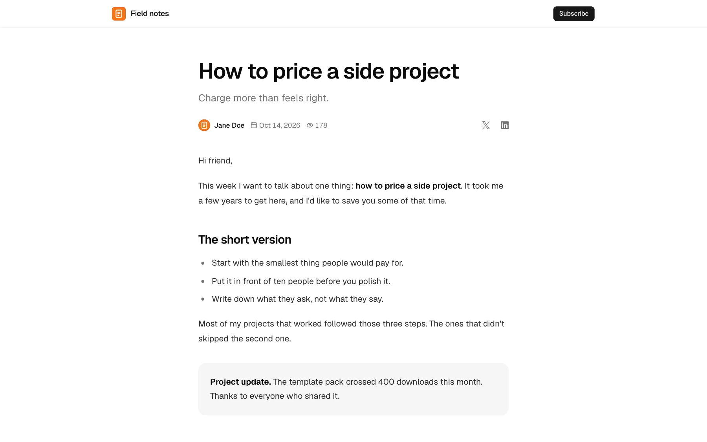

# MailCheap

MailCheap is a newsletter app: write an issue, send it to your list, publish it on the web. Self-host it free with your own Amazon SES or PostShiba account, or let us run it on [MailCheap Cloud](https://mailcheap.ai).



> [!IMPORTANT]
> **No support.** Issues are off, and setup questions go unanswered. Fork it, deploy it, make it yours. Or let us run it: [mailcheap.ai](https://mailcheap.ai).

## Self-host it free, or let us run it

This repository is the whole app: the dashboard, the public archive, the REST API, the MCP server and the docs. This fork runs it on Cloudflare (Workers, D1, R2, Queues, Durable Objects), provisioned by [Alchemy](https://alchemy.run). MailCheap Cloud runs this same code with `MAILCHEAP_CLOUD=true`, which adds plans and Stripe billing, and our own sending accounts. Its marketing site (the landing, pricing and legal pages) isn't part of the open source. Every change to the app ships to both.

| | Self-hosted | MailCheap Cloud |
| --- | --- | --- |
| Price | Free, plus what your provider charges per email | From $19 a month |
| Sending | Your Amazon SES or PostShiba account | Ours, set up for you |
| Who signs in | The emails you allow | Anyone who signs up |
| Limits | None | Emails per month and subscribers, per plan |
| Setup | About an hour, most of it waiting for DNS and production access | A few minutes |

## Why

Newsletter platforms charge for every subscriber, every month. With your own sending account you pay for the emails you send: 10,000 readers and 4 issues a month is 40,000 emails, about $4 to $6 on Amazon SES.

MailCheap is the rest of what a newsletter needs, in one Next.js app on Cloudflare Workers: an editor, a list, signup forms, unsubscribe handling, bounce and complaint handling, stats and a public archive. Your list stays in your database, and everything the dashboard does also works from an AI agent, through a REST API and an MCP server.

## Features

**Write and send**

- Editor with a live email preview, slash commands and boxes. Images are dropped in, pasted, or picked from the ones you uploaded before. Markdown and raw HTML work too.
- Merge tags greet each reader by name: `{{first_name|there}}` becomes their first name, or "there" when they have none, in the subject, preview text and content. The archive shows the fallback.
- Checks before every send: subject, preview text, unsubscribe link, size under Gmail's 100 KB clip, postal address, verified domain.
- Test emails, scheduling, and sending in batches through a Cloudflare Queue.
- One issue in several languages: each contact gets the edition in theirs, read from imports or set by hand, and contacts without one, or in a language the issue isn't in, get the newsletter's. An issue in one other language alone goes to that language's readers alone.
- Send in steps: start with your most engaged readers, then send to more. A first send to contacts never mailed goes out in steps by itself: a 5% slice, then the rest 3 hours later if its bounces and complaints stay low.

**Grow the list**

- A signup form on the archive, and a signup API with API keys.
- Confirmed opt-in, on by default. Welcome email.
- CSV import from any platform, first and last names included. It leaves out invalid, misspelled (gmial.com), spam trap, role, throwaway, duplicate and suppressed addresses, and addresses on domains that can't receive email, and records that your readers agreed. Signups refuse misspellings with a suggestion.
- Check addresses on the contacts page: it finds contacts on misspelled domains or domains that can't receive email, which you delete or keep.
- Contacts you add by hand are subscribed at once, without a confirmation email, once you tick that they agreed. MailCheap records who ticked it and when.
- Rate limits on signups, sign-in, unsubscribes, slug changes, the API, and the dashboard's test emails, sends, imports and uploads, on by default. An account's API keys, connected apps and dashboard share its limits, so more keys don't raise them.

**Keep it healthy**

- Bounce and complaint handling, and a suppression list per account.
- A send pauses past 2% hard bounces (at least 5) or 0.08% complaints (at least 2), and its owner gets an email and can resume it. One complaint alone never stops anything.
- Clear abuse blocks the whole account until an admin unblocks it: a send, a first send's slice or the last 7 days past 5% hard bounces (at least 10) or 0.3% complaints (at least 3), a spam trap hit, or the email provider stopping the account. Nothing goes out while it's blocked, welcome emails included, and the tracked links in its emails show a page saying they're disabled instead of redirecting; unsubscribe and confirmation links keep working.
- On MailCheap Cloud, a new account's campaigns go out over 24, 16 and 12 hours, then 8, for its first 30 days. One account per inbox (jane.doe+2@gmail.com is jane.doe@gmail.com), no throwaway inboxes, and 3 new accounts a day per IP address.
- One-click unsubscribe (RFC 8058 `List-Unsubscribe` headers) and an unsubscribe page, with signed links.
- List cleanup, on by default: readers who ignored several issues get one "do you still want this?" email, then stop getting issues.
- Open and click tracking on your own domain, with link scanners filtered out.

**Publish and measure**

- A public archive: issue pages, author page, share images, sitemap. On a subdomain of your own if you want.
- Overview with subscribers over time, emails per hour, and delivery, open, click, bounce and complaint rates.
- Campaign reports by mailbox provider (Gmail, Outlook, Yahoo, iCloud...).
- A domains page with each domain's DKIM and return path status and the DNS records to add.

**For agents**

- Every dashboard action works through a REST API at `/api/v1` and an MCP server at `/mcp`, with the same API keys and the same checks.
- Docs at `/docs`, an OpenAPI document and `/llms.txt` on your server.

**Accounts**

- Sign-in with a code by email, or with Google. On a self-hosted server, only the emails you allow.
- One account per person, with up to 3 newsletters, each with its contacts and campaigns, and the account's domains and API keys, which they share. The dashboard shows one newsletter at a time: a menu under the logo switches. Admins see every account and can block or unblock it, or give it a free plan on MailCheap Cloud.
- An account page for the name and photo, the email and billing, and deleting the account: it stops at once, and its data is deleted 30 days later unless its owner signs in and restores it.

## Screenshots

| Editor | Campaign report |
| --- | --- |
|  |  |
| **Contacts** | **Public archive** |
|  |  |

<details>
<summary>Issue page</summary>



</details>

All names and addresses in the screenshots are made up.

## What you need

| Service | For | Cost |
| --- | --- | --- |
| [Cloudflare Workers Paid](https://developers.cloudflare.com/workers/platform/pricing/) | Hosting (two Workers), D1 database, R2 images and backups, Queues, Durable Objects, cron | $5/month base, plus usage beyond the included amounts |
| [Amazon SES](https://aws.amazon.com/ses/) or [PostShiba](https://postshiba.com) | Sending | SES: $0.10 to $0.16 per 1,000 emails, depending on its pricing plan. PostShiba: a fixed price per cluster, invite only for now |
| A domain on Cloudflare (recommended) | Dashboard, email links, images | Your registrar's price |
| [Resend](https://resend.com) (optional) | Sign-in codes and alerts. Without it, they go through SES or PostShiba | Free plan works |

[Alchemy](https://alchemy.run) creates and wires every Cloudflare resource from [`alchemy.run.ts`](alchemy.run.ts): you never create a database, bucket or queue by hand. The app runs on [vinext](https://vinext.dev), Cloudflare's Vite-based implementation of the Next.js API. Rate limits and the send rate are shared by every Worker instance through Durable Objects, and image uploads go to R2.

## Self-hosting

Plan for about an hour, most of it waiting for DNS and for your provider to approve production sending.

### 1. Install

Node.js 24.11+ (see `.nvmrc`) and npm:

```bash
git clone https://github.com/<you>/mailcheap.git && cd mailcheap
npm ci
cp .env.example .env
```

In `.env`, set `BETTER_AUTH_SECRET` (at least 32 characters: `openssl rand -base64 48`), `ADMIN_EMAILS` (your email) and `EMAIL_FROM` (like `MailCheap <login@mail.example.com>`, on a domain your Resend account, Cloudflare Email Service or email provider verified). Generate a new secret for each install and keep it: email links depend on it, and with a short one MailCheap refuses to start. `.env` is ignored by Git.

Sign-in codes need a way to reach you. The quickest is [Resend](https://resend.com): verify `EMAIL_FROM`'s domain there and add `RESEND_API_KEY`. Or [Cloudflare Email Service](https://developers.cloudflare.com/email-service/): onboard `EMAIL_FROM`'s domain, then add `CLOUDFLARE_EMAIL_API_TOKEN` (a token that can send emails) and `CLOUDFLARE_EMAIL_ACCOUNT_ID`. With both set, `PLATFORM_EMAIL_PROVIDER` (`resend` or `cloudflare`) picks one; Resend without it. Without either, codes go through SES or PostShiba once step 6 is done; in local development they're printed in the console.

### 2. Connect Alchemy to Cloudflare

Create an Alchemy profile and connect your Cloudflare account (`npx alchemy profile create`, then `npx alchemy profile edit`; `npx alchemy provider cloudflare --help` lists the prerequisites). In CI, set `CLOUDFLARE_ACCOUNT_ID` and `CLOUDFLARE_API_TOKEN` instead.

Deployment state lives in your Cloudflare account (`Cloudflare.state()`), so any machine with access can deploy the same stages. **The first `plan`, `deploy` or non-local `dev` creates that state store** (a small Worker, a Durable Object and Secrets Store entries) in the account. Nothing else needs creating by hand.

### 3. Try it locally

```bash
npm run dev
```

This runs `alchemy dev --stage local`: both Workers with local D1, R2, Queues, Durable Objects and cron, state in `.alchemy/` (ignored). Open the printed URL and sign in at `/signin` with your email. Nothing is sent while `SENDING_ENABLED` isn't `true`. Never point `dev` at `--stage prod`: it would replace that stage's Workers.

### 4. Deploy

Set `APP_DOMAIN` (and optionally `ASSET_DOMAIN`) to subdomains of a zone on the same Cloudflare account before your first real email: every link in sent emails uses them. Then:

```bash
npm run deploy -- --stage prod
```

Use a separate env file per stage if their values differ (`--env-file .env.prod`). The deploy:

1. creates or reuses D1, the R2 asset and backup buckets, the jobs queue and its dead-letter queue;
2. applies new SQL files from `migrations/` to D1, in order and once each (they're recorded in D1), before the new code goes live;
3. builds and deploys the app Worker (dashboard, APIs, MCP, archive, webhooks, rate-limit and send-pacing Durable Objects) and the jobs Worker (queue consumer, minute cron, daily backup);
4. prints `url` and the webhook URLs: `sesWebhookUrl`, `sesTenantWebhookUrl`, `postshibaWebhookUrl` and `stripeWebhookUrl`.

Running it again updates the same resources and keeps their data. In `prod`, D1 and both buckets are retained even if the stack is destroyed. Try `--stage staging` first: each stage has its own resources and secrets.

`/api/health` answers 200, or 503 with what to fix. Sending stays off until you finish the next steps, so nothing goes out to readers by mistake.

### 5. Who can sign in

Only the emails you list: `ADMIN_EMAILS` (who can also open `/admin`) and `ALLOWED_EMAILS`, a comma-separated list of addresses and whole domains, like `jane@example.com, @example.org`. It's checked at every sign-in, with a code or with Google, and anyone you take off the list is signed out and loses their API keys at their next request. With both lists empty, nobody can sign in.

Everyone gets an account of their own, with up to 3 newsletters and their contacts and campaigns, and the account's domains and API keys. There's no billing on a self-hosted server: no plans, no limits.

### 6. Email provider

Pick Amazon SES or PostShiba (invite only for now). `EMAIL_PROVIDER` picks one; without it, MailCheap uses PostShiba when `POSTSHIBA_API_KEY` is set and SES otherwise. Every account gets its own tenant there, with its own domains, suppression list and pause switch. MailCheap creates them; you set up the provider account and its events once.

#### Amazon SES

Use one AWS region for everything below (the examples use `us-east-1`). An AWS account just for MailCheap is best: SES reputation and limits are per AWS account.

1. **Request production access.** New accounts are in the sandbox (200 emails a day, verified recipients only). In **Account dashboard > Request production access**, pick Marketing, and explain that readers opt in, that bounces and complaints are suppressed automatically, and that every email has one-click unsubscribe. AWS usually answers within a day.
2. **Create an SNS topic** for events, like `mailcheap-ses-events`, and switch it to signature version 2, which signs messages with SHA256 instead of SHA1: `aws sns set-topic-attributes --topic-arn <topic-arn> --attribute-name SignatureVersion --attribute-value 2`. Then **Create subscription** with protocol HTTPS and endpoint `https://<your-app>/api/webhooks/ses` (the deploy's `sesWebhookUrl`), raw message delivery off. MailCheap confirms the subscription by itself once it's deployed with the variables of step 4 below.
3. **Create an IAM user for MailCheap** with this policy, then create an access key for it:

```json
{
  "Version": "2012-10-17",
  "Statement": [
    {
      "Effect": "Allow",
      "Action": [
        "ses:SendEmail",
        "ses:GetAccount",
        "ses:CreateTenant",
        "ses:GetTenant",
        "ses:DeleteTenant",
        "ses:TagResource",
        "ses:CreateTenantResourceAssociation",
        "ses:DeleteTenantResourceAssociation",
        "ses:UpdateReputationEntityPolicy",
        "ses:UpdateReputationEntityCustomerManagedStatus",
        "ses:CreateConfigurationSet",
        "ses:CreateConfigurationSetEventDestination",
        "ses:DeleteConfigurationSet",
        "ses:CreateEmailIdentity",
        "ses:GetEmailIdentity",
        "ses:PutEmailIdentityMailFromAttributes",
        "ses:DeleteEmailIdentity"
      ],
      "Resource": "*"
    }
  ]
}
```

4. **Add the variables to `.env`** and deploy again: `SES_REGION`, `SES_ACCESS_KEY_ID`, `SES_SECRET_ACCESS_KEY`, `SES_AWS_ACCOUNT_ID` (the 12-digit account ID) and `SES_SNS_TOPIC_ARN`. Each account's configuration set publishes its events to that topic.
5. **Optional: tenant pauses.** SES pauses tenants that send badly. To block the account in MailCheap too, send SES's tenant status and reputation finding events from EventBridge to a second SNS topic, subscribe `https://<your-app>/api/webhooks/ses-tenants` to it, and set `SES_TENANT_SNS_TOPIC_ARN`.

Without Resend, sign-in codes and alerts go out through SES from `EMAIL_FROM`, outside every tenant, so its domain has to be verified in the AWS account before your first sign-in: **Identities > Create identity > Domain**, with Easy DKIM. In the sandbox, the addresses you sign in with have to be verified too.

#### PostShiba

PostShiba approves production sending by hand: until then, sends to anyone outside your team answer `kyc_required` (campaigns pause with that reason) and a team can have one cluster.

1. **Team and key.** In API keys, create a full access key: `POSTSHIBA_API_KEY`, with the team id as `POSTSHIBA_TEAM_ID`. Add a payment method (clusters need one).
2. **Clusters.** One `bulk` cluster sends every email: its id goes in `POSTSHIBA_BULK_CLUSTER_ID`. Later, a `transactional` cluster in `POSTSHIBA_TRANSACTIONAL_CLUSTER_ID` takes welcome, confirmation and test emails, so they never wait behind a campaign. Set `SEND_RATE_PER_SECOND` to the bulk cluster's hourly cap divided by 3,600, less what welcome and test emails need when they share it. At a cap, PostShiba answers `throttled`: the batch goes back to the outbox and the queue brings it after the hour.
3. **Webhook.** One endpoint for the whole team (no cluster or tenant) at `https://<your-app>/api/webhooks/postshiba` with the events `processed`, `delivered`, `deferred`, `bounce`, `dropped`, `spamreport` and `unsubscribe`. Its secret goes in `POSTSHIBA_WEBHOOK_SECRET`.
4. **Encryption key.** `CREDENTIALS_ENCRYPTION_KEY`, generated once with `openssl rand -base64 32`. It encrypts each tenant's SMTP password.

MailCheap creates the rest: a tenant per account (slug `mc-<accountId>`), an SMTP credential for it on each cluster (one in all on a single cluster), and its domains. Creating credentials and domains and running domain checks share PostShiba's budget of 60 an hour per key; a failed setup is retried at the account's next send.

Without Resend, sign-in codes and alerts go through a tenant of their own, `mc-platform`, on the transactional cluster. The first one adds `EMAIL_FROM`'s domain there, and the server log lists the two CNAME records it needs; once PostShiba finds them, codes go out. A domain belongs to one tenant at PostShiba, so `EMAIL_FROM` needs a domain or subdomain that no newsletter sends from.

### 7. Turn sending on

1. In MailCheap, open **Domains** and add the domain your newsletter sends from. Use a subdomain like `mail.example.com`, so your main domain's email is unaffected. Add the DNS records it lists (DKIM, return path, and DMARC if your root domain has none), then click **Check now**.
2. Create your newsletter. The from address must be on that domain, and the postal address shows in every email's footer (anti-spam laws require one).
3. Set `SENDING_ENABLED=true` and deploy again. On a staging stage, only send to your own test addresses.
4. Write a campaign, send yourself a test, then send. A first send to new contacts goes out in steps by itself; for a new domain, also set a limit to reach your most engaged readers first, and use **Send to more** on the report once the first step looks healthy.

### Optional

- **Archive on its own subdomain.** Each domain comes with an archive subdomain (`news.<domain>` by default). Set `ARCHIVE_CNAME_TARGET` to the host it should point at (the app Worker's custom domain) and make the app Worker answer for the subdomain: a custom domain on the Worker when the zone is on your Cloudflare account, or a [Cloudflare for SaaS](https://developers.cloudflare.com/cloudflare-for-platforms/cloudflare-for-saas/) custom hostname on the app's zone when it isn't. MailCheap doesn't add it for you. Once its CNAME resolves, **Check now** moves the archive, tracked links and unsubscribe links there.

  This is the safer setup: issue pages show HTML from your editor and from API keys, and on their own domain that HTML never shares the dashboard's origin. Without one, the archive stays at `/archive/<slug>` on the app's domain, where the sanitizer, the sandboxed frame and the Content Security Policy protect it.
- **Shared domain.** `SHARED_DOMAIN` gives every newsletter without a domain of its own an address of its own, `hello@<slug>.SHARED_DOMAIN`, and its archive at `<slug>.SHARED_DOMAIN`. MailCheap adds each subdomain at the provider and has its records published, and removed when the slug changes, by a DNS helper (`DNS_BROKER_URL`, `DNS_BROKER_SECRET`): a separate service that holds the DNS provider's token, so the app never does, and only writes a shared address's records. Without one, DNS automation is off and shared addresses can't be set up. `*.SHARED_DOMAIN` has to reach the app Worker (a wildcard route or custom hostname). Add one DMARC record for the whole domain yourself: `_dmarc.SHARED_DOMAIN` TXT `v=DMARC1; p=none;`. It can be the app's own domain, as MailCheap Cloud's is `mailcheap.ai`: slugs can't take `www` or the other names in `lib/reserved-slugs.js`, and those hosts never open an archive. Without a shared domain, every newsletter sends from a domain of its own.
- **Google sign-in.** Create an OAuth client (web application) with the redirect URI `<APP_URL>/api/auth/callback/google`, then set `GOOGLE_CLIENT_ID` and `GOOGLE_CLIENT_SECRET`. The allowlist applies, and a Google sign-in joins an existing user only when Google verified that email.
- **Image uploads** work out of the box: they go to the R2 asset bucket the stack creates, under `accounts/<accountId>/images/`, served by the app at `/media` or, with `ASSET_DOMAIN` set, from that domain (a custom domain on the bucket). Each image gets a name that never changes and `Cache-Control: public, max-age=31536000, immutable`. An account's purge deletes its images from R2; on an `ASSET_DOMAIN`, Cloudflare's cache can keep serving one until it expires.
- **Deploy from GitHub:** `.github/workflows/deploy.yml` runs the same `npm run deploy` for a chosen stage. Add the secrets and variables it lists to a GitHub environment named after the stage.

## Deliverability basics

- **Send from a subdomain** (`mail.example.com`), so a bad week doesn't affect your main domain's email.
- **Authenticate everything:** DKIM, SPF through the custom return path, and DMARC on the root domain.
- **Only email people who asked.** Never import a bought or scraped list. If bots fill your forms, turn on confirmed opt-in.
- **Warm up a new domain.** Send to your most engaged readers first, and grow each send over a few weeks.
- **Watch complaints and bounces.** Keep complaints under 0.1% and bounces under 2%. MailCheap pauses a send past 0.08% complaints or 2% bounces, and blocks the account past 0.3% complaints or 5% bounces. Add your domain to [Google Postmaster Tools](https://postmaster.google.com) to see your spam rate at Gmail.
- **Make leaving easy.** Every email has one-click unsubscribe headers and a footer link, which Gmail and Yahoo require.
- **Clean your list.** Keep list cleanup on to stop emailing people who never open. New newsletters start with it on.
- **Keep emails under 100 KB**, or Gmail clips them and hides the unsubscribe link.

## Operations and recovery

- **Logs:** both Workers have Workers Logs on; `npx alchemy logs --tail --stage prod` follows them. Look for `[jobs]`, `[cron]`, `[alert]` and `[activity]` lines.
- **Stop everything:** deploy with `SENDING_ENABLED=false`. Both Workers stop sending at once; queued messages stay queued and go out after you turn it back on.
- **Unconfirmed sends:** when the provider doesn't answer a send (a timeout, a Worker that stopped mid-send), the message becomes `ambiguous` and is never resent automatically, because it may have gone out. A provider event for it later settles it. Never reset those messages to `queued` by hand.
- **Jobs:** every job (send batches, scheduled sends, first-send checks, provider events, account purges) is written to D1 (`job_outbox`) before it's published, and the minute cron publishes anything left behind and restarts stalled sends. Jobs that fail 8 times land in the `JobsDeadLetters` queue; their work stays in D1 and the cron picks the campaign up again.
- **Scheduled sends** start within about a minute of their time, subject to the queue backlog.
- **Backups:** D1 Time Travel can restore the database to any minute of the last 30 days (`npx wrangler d1 time-travel restore <database> --timestamp <time>`). MailCheap also writes a daily snapshot of every table to the private backups bucket (`backups/<date>/`). To restore one into a new, empty database created by the same migrations: download the folder, then `node scripts/backup-to-sql.mjs ./<date> > restore.sql` and `npx wrangler d1 execute <database> --remote --file restore.sql`. Turn sending off first.
- **Rolling back code:** only to a version that works with the current schema. Migrations only add to the schema; never edit one that has been applied.
- **Lost deployment state:** the state lives in your Cloudflare account, not on your machine. Keep the logical IDs in `alchemy.run.ts` unchanged, or Alchemy will create new resources instead of reusing the old ones.

## Environment variables

Set them in `.env` (one file per stage if they differ); Alchemy turns each into a Worker variable or secret (`alchemy.run.ts`). Cloudflare resources are bound by the stack, so there are no database, queue or storage URLs.

| Variable | Self-hosted | MailCheap Cloud | What it does |
| --- | --- | --- | --- |
| `BETTER_AUTH_SECRET` | Required | Required | Signs sessions and every link in sent emails. 32+ random characters, or the server refuses to start. Rotating it signs everyone out and breaks links in emails already sent |
| `APP_DOMAIN` | Recommended | Recommended | The app's domain, on a zone in the same Cloudflare account. Alchemy sets `APP_URL` (email links, sign-in, Stripe return URLs, the docs) to `https://APP_DOMAIN`, or the Worker's workers.dev URL without it |
| `ASSET_DOMAIN` | Optional | Optional | Serves uploaded images from the R2 bucket on this domain. Without it, the app serves them at `/media` |
| `ADMIN_EMAILS` | Required | Optional | Comma-separated emails that can open `/admin`. On a self-hosted server they can also sign in |
| `ALLOWED_EMAILS` | Optional | Not used | Who else can sign in to a self-hosted server: addresses and `@domain` entries, comma-separated |
| `RATE_LIMITS` | Optional | Optional | An action's limit instead of its default, in the same window, per key and per account: `add_domain=50,send_test_email=100`. `/docs/authentication` lists the limits |
| `EMAIL_FROM` | Required | Optional | From address of sign-in codes and alerts. MailCheap Cloud uses `MailCheap <hello@r.mailcheap.ai>` without it, with replies to `hello@mailcheap.ai` |
| `RESEND_API_KEY` | Optional | Required, or Cloudflare | Sign-in codes and alerts through Resend. Self-hosted without it or Cloudflare, they go through the email provider; MailCheap Cloud never does that and refuses to start without one of them |
| `CLOUDFLARE_EMAIL_API_TOKEN`, `CLOUDFLARE_EMAIL_ACCOUNT_ID` | Optional | Required, or Resend | Sign-in codes and alerts through Cloudflare Email Service instead: a token that can send emails, and the account `EMAIL_FROM`'s domain is onboarded on |
| `PLATFORM_EMAIL_PROVIDER` | Optional | Optional | `resend` or `cloudflare`, when both are set. Default: Resend. Naming one without its keys, or any other value, stops sign-in codes and alerts (and MailCheap Cloud refuses to start) |
| `MAILCHEAP_CLOUD` | Unset | `true` | Turns on open sign-up, plans and Stripe billing. Only exactly `true` counts. |
| `STRIPE_SECRET_KEY`, `STRIPE_WEBHOOK_SECRET` | Not used | Required | Billing, and the signing secret of `<APP_URL>/api/webhooks/stripe`. MailCheap Cloud refuses to start without them |
| `GOOGLE_CLIENT_ID`, `GOOGLE_CLIENT_SECRET` | Optional | Optional | Google sign-in. Redirect URI `<APP_URL>/api/auth/callback/google` |
| `SENDING_ENABLED` | To send | To send | Nothing goes to readers unless it's `true`. Sign-in codes and alerts don't wait for it |
| `EMAIL_PROVIDER` | Optional | Optional | `postshiba` or `ses`. Default: `postshiba` when `POSTSHIBA_API_KEY` is set, else `ses`. Any other value stops sending |
| `POSTSHIBA_API_KEY`, `POSTSHIBA_TEAM_ID` | For PostShiba | For PostShiba | A full access key of the PostShiba team, and the team id |
| `POSTSHIBA_BULK_CLUSTER_ID` | For PostShiba | For PostShiba | The cluster every email goes out on: campaigns and last-chance emails over HTTP inject, every other email through `POST /sends` |
| `POSTSHIBA_TRANSACTIONAL_CLUSTER_ID` | Optional | Optional | A second cluster for welcome, confirmation and test emails; without it they share the bulk one |
| `POSTSHIBA_WEBHOOK_SECRET` | For PostShiba | For PostShiba | Signing secret of `<APP_URL>/api/webhooks/postshiba` |
| `POSTSHIBA_API_URL`, `POSTSHIBA_INJECT_URL` | Optional | Optional | Default `https://app.postshiba.com` and `https://inject.postshiba.com/api/inject/v1` |
| `CREDENTIALS_ENCRYPTION_KEY` | For PostShiba | For PostShiba | 32 random bytes in base64 (`openssl rand -base64 32`). Encrypts each tenant's SMTP password at rest. Changing it makes the stored passwords unreadable |
| `SES_REGION`, `SES_ACCESS_KEY_ID`, `SES_SECRET_ACCESS_KEY` | For SES | For SES | SES region (default `us-east-1`) and the IAM user's keys. Never default AWS credentials |
| `SES_AWS_ACCOUNT_ID` | For SES | For SES | ID of the AWS account, for identity ARNs |
| `SES_SNS_TOPIC_ARN` | For SES | For SES | Events of every account's configuration set, at `/api/webhooks/ses` |
| `SES_TENANT_SNS_TOPIC_ARN` | Optional | Used | Tenant pauses and reputation findings from EventBridge, at `/api/webhooks/ses-tenants` |
| `SHARED_DOMAIN` | Optional | Used | Shared domain, `mailcheap.ai` on MailCheap Cloud: newsletters without a domain of their own send from `hello@<slug>.SHARED_DOMAIN` and have their archive at `<slug>.SHARED_DOMAIN` |
| `ARCHIVE_CNAME_TARGET` | Optional | Used | What archive subdomains point at with a CNAME (the app Worker's custom domain) |
| `DNS_BROKER_URL`, `DNS_BROKER_SECRET` | With `SHARED_DOMAIN` | Used | The DNS helper that publishes the shared subdomains' records, and the secret that signs each request to it |
| `SES_ENDPOINT` | Local only | Not used | `npm run dev` only: a mock SES to send to instead of AWS |
| `SEND_RATE_PER_SECOND` | Optional | Optional | Campaign emails per second across all accounts, default 14: SES's max send rate, or PostShiba's bulk cluster cap per hour / 3,600 |

[`.env.example`](.env.example) has the same list with more detail.

## REST API and MCP

Create a key on the **API keys** page and send it as `Authorization: Bearer <key>`. A full access key can do everything the dashboard can; a signups only key can only add contacts, for keys that sit in a website's code. Every key gets 300 requests a minute.

**Add a contact**: `POST /api/v1/contacts`

```bash
curl -X POST https://<your-app>/api/v1/contacts \
  -H "Authorization: Bearer $MAILCHEAP_API_KEY" \
  -H "Content-Type: application/json" \
  -d '{"email":"jane@example.com","source":"website","ip":"203.0.113.7"}'
```

**MCP**: connect Claude Code with a full access key. Every action is a tool, and sending is marked as one that can't be undone, so your agent asks you first.

```bash
claude mcp add --transport http --scope user mailcheap https://<your-app>/mcp \
  --header "Authorization: Bearer $MAILCHEAP_API_KEY"
```

**ChatGPT, Claude and Grok Bot** add `https://<your-app>/mcp` as a connector or custom MCP server and sign in with OAuth: the user signs in to MailCheap, allows the app on a consent page, and the app gets full access to that account. Better Auth is the authorization server (issuer `APP_URL`, discovery at `/.well-known/oauth-authorization-server`), apps identify themselves with a client metadata document (Grok Bot, on Cursor's agents, registers instead, with redirect URIs from the allowlist in `lib/oauth-rules.js`), and access tokens are bound to `/mcp`. The **API keys** page lists connected apps and revokes them. The server has to be reachable over HTTPS from the internet for them.

`/docs` on your server has every endpoint, the errors, the MCP setup for ChatGPT, Claude, Grok Bot, Claude Code, Codex and Cursor, and the OpenAPI document at `/api/v1/openapi.json`. On MailCheap Cloud, the same at [mailcheap.ai/docs](https://mailcheap.ai/docs) and `https://mailcheap.ai/mcp`.

## Local development

You need Node.js 24.11+ (see `.nvmrc`). No database or other service to install: `npm run dev` runs both Workers with local D1, R2, Queues, Durable Objects and cron.

```bash
git clone https://github.com/<you>/mailcheap.git && cd mailcheap
npm ci
cp .env.example .env   # set BETTER_AUTH_SECRET, ADMIN_EMAILS
npm run dev
```

- Without `MAILCHEAP_CLOUD` it runs as a self-hosted server: sign in with an email in `ADMIN_EMAILS` or `ALLOWED_EMAILS`. Without `RESEND_API_KEY` or Cloudflare Email Service's keys, development prints the code in the console (`[signin] Code for ...`); production never does.
- Restarting keeps the local data in `.alchemy/local`; delete that folder for a fresh database. Migrations in `migrations/` apply on start.
- Trigger the jobs Worker's cron by hand: open `/cdn-cgi/handler/scheduled?cron=*+*+*+*+*` on the jobs Worker's local URL.
- To work on MailCheap Cloud's own parts, set `MAILCHEAP_CLOUD=true` with Stripe test keys and a Resend key: the cloud doesn't start without them. Run `stripe listen --forward-to <local-url>/api/webhooks/stripe` and use its signing secret as `STRIPE_WEBHOOK_SECRET`.
- Sending stays off unless `SENDING_ENABLED=true`. SES needs `SES_ACCESS_KEY_ID` and `SES_SECRET_ACCESS_KEY` (a Worker has no `~/.aws`), or `SES_ENDPOINT` pointing at a mock SES. PostShiba needs its four ids and keys and `CREDENTIALS_ENCRYPTION_KEY`.
- `npm run plan -- --stage staging` previews a deploy.

## Tests

```bash
npm test       # unit and integration tests (Node.js 24.11+)
npm run lint
npm run check:cloudflare
```

Integration tests (sign-in, isolation, billing, plan limits, admin, sending, domains, PostShiba, its webhook, the REST API, MCP, parity, the public site, self-hosting, MailCheap's own emails, the account page and deleting an account) run on an in-memory SQLite database with the real migrations, standing in for D1 (`tests/helpers/d1.mjs`), with in-memory R2 and Queue bindings (`tests/helpers/app.mjs`); jobs run by calling the queue consumer (`worker/jobs.js`). They import server actions and route handlers as they are: `tests/setup` resolves the `@/` alias and `cloudflare:workers`, and replaces Next.js request APIs, SES (`lib/ses.js`), DNS lookups, the DNS helper and image downloads with the stubs in `tests/stubs`. Stripe, Resend, Google's token endpoint and PostShiba are answered by a mocked `fetch` (`tests/helpers/postshiba.mjs` is an in-memory PostShiba); nothing reaches the network. Tests run as MailCheap Cloud on SES unless they say otherwise: `tests/self-host.test.mjs` runs as a self-hosted server, `tests/platform-email.test.mjs` as both.

`tests/parity.test.mjs` walks the action registry and fails when an action has no REST route, no MCP tool (listed through the real `/mcp` route), no entry in the OpenAPI document, the docs or the llms files, or an input without a description, and when a dashboard server action does anything but run a registered action. The account page's profile and deletion are the exception: like sign-in, no API key or app may reach them. `tests/mcp.test.mjs` also connects the official MCP client on the 2026-07-28 revision and with the 2025 handshake. `tests/oauth.test.mjs` connects it with OAuth the way ChatGPT and Claude do (discovery, a client metadata document served from memory by `tests/stubs/cimd-node.mjs`, PKCE, sign-in and consent, refresh) and the way Grok Bot does (registration, with the allowlist and its rate limit), and checks scopes, revocation and accounts kept apart.

## How it works

- Next.js App Router API on [vinext](https://vinext.dev), JavaScript, Tailwind CSS with shadcn/ui, Cloudflare D1 through plain parameterized SQL (`lib/db.js`, `lib/records.js`, schema and triggers in `migrations/`), Better Auth for sign-in (on D1 too).
- **Two modes, one switch.** `isCloud()` in `lib/config.js` is `MAILCHEAP_CLOUD === "true"`. Without it there's no billing (every account counts as paid, `getAccountLimits()` is `null`, the billing actions answer `billing_off`) and sign-in is limited to the allowlist. MailCheap Cloud's marketing site, which isn't part of the open source, plugs into the shared pages through `lib/site-extensions.js` and `components/SiteExtensions.jsx`; their defaults add nothing, so `/` is the dashboard, or sign-in without a session.
- **Scoping.** Every customer table has a required `accountId`, and every query names it. The few lookups that have to find a row across accounts say so in a comment: tracking links (by message id), unsubscribe, confirm and keep links (signed tokens), archives (public slugs), the API key lookup (the key decides the account) and the global uniqueness of archive slugs.
- **Who's asking.** Pages and server actions call `requireAccount()`, the REST API and MCP call `authenticateRequest()` (API key to account and level), all in `lib/auth.js` and `lib/api-keys.js`. MCP also takes OAuth access tokens: `authenticateAccessToken()` in `lib/oauth.js` checks the token against Better Auth's signing keys, its audience (`/mcp`), its scope and the connected app it names, then works in the token's user's account. `proxy.js` only checks that a session cookie is there. On MailCheap Cloud the dashboard opens without a plan: an action marked `tryWithoutPlan` (setting up the newsletter, writing campaigns, adding 5 contacts a day by hand, reading) runs from the dashboard, and the others (sending, imports, domains, API keys) answer `subscription_required`, which opens the paywall. The REST API and MCP need a plan for everything but billing.
- **OAuth.** `lib/auth.js` adds Better Auth's JWT, MCP and client metadata document plugins. Sign-in (`/signin`) and the consent page (`/oauth/consent`) carry Better Auth's signed authorization request; Better Auth creates its RS256 signing key in the `jwks` table on first use. A connected app is an `oauthConsent` row; disconnecting it deletes its tokens and the consent, and every access token names its consent, so it stops at once.
- **Sign-in.** Codes are sent and checked by server actions with the app's rate limits; Better Auth's own code routes are closed. On a self-hosted server, Better Auth's user and session hooks refuse anyone off the allowlist, whatever the route, and `getSession()` ignores anyone taken off it since.
- **Actions.** Every customer action is one `defineAction` in `lib/actions/<group>.js`: an HTTP route, zod input and output schemas, a permission (`full` or `signups`), MCP hints, an optional rate limit, per key and per account, and a handler. `dashboardInput` adds fields only the dashboard sends, like Add contact's consent box: the REST API and MCP don't take them. `runAction` (`lib/actions/run-action.js`) is the only way to run one, from the dashboard, the REST API (`app/api/v1/[...path]`) or MCP (`/mcp`, `lib/mcp/server.js`). `lib/docs` builds the OpenAPI document, `/docs/api` and `/llms-full.txt` from the same schemas.
- **Send** picks the audience in bounded pages (active contacts, suppressions left out, most engaged first), creates one message per reader, and commits one job per batch of 50 to D1 together with the status change. The jobs Worker consumes them from a Cloudflare Queue, claims each message before calling the provider (an unanswered call leaves it `ambiguous`, never resent), paces every send through one Durable Object at `SEND_RATE_PER_SECOND` and checks the campaign's bounce and complaint rates against the two levels in `LIMITS` (`lib/config.js`): past the pause level the campaign pauses, past the block level the account is blocked (`lib/account-blocks.js`). During an account's first 30 days the batches spread over hours (`lib/send-spread.js`), and contacts never mailed wait behind a first slice (`lib/first-send.js`). Welcome and confirmation emails go out right away, capped at 100 every 10 minutes per newsletter. A minute cron starts due scheduled campaigns, publishes jobs left in D1 and restarts stalled sends.
- **Email providers.** `lib/email-provider` is the one switch: each adapter (`ses.js`, `postshiba.js`) does tenants, domains and sends, and its errors carry a stable outcome that the batch turns into retry later, skip the address, pause the campaign or fail the email. Both providers' webhooks verify each event and store it in D1 before answering; the jobs Worker then applies it. Both providers' events become one shape (`lib/email-event-rules.js`) and are recorded once, only in the account they name; counters move in SQL triggers.
- **Images** (`lib/image-storage.js`): uploads from the editor, the newsletter settings and `upload_image` go to the R2 asset bucket under `accounts/<accountId>/images/` with a random part in the name. Nothing is moved, and nothing is deleted until its account is, since sent emails point at the URLs. Each upload is a row in `uploads`, which the image picker and `list_images` list and the purge deletes files by; a file whose row can't be saved is deleted right away.
- **Deleting an account** (`lib/account-deletion.js`, `lib/account-purge.js`) only happens on its page, with a code sent for it: never through the REST API or MCP. It's refused while Stripe bills a plan or a campaign sends or is scheduled. At once, every session ends, API keys and connected apps stop, the account counts as unpaid (no sends, signups or archive) and its tenant is suspended. An outbox job runs 30 days later, unless signing in restored the account: it deletes the user, everything with the account's id, its domains and shared subdomains at the provider and in DNS, its tenant and its images, and keeps a deletion record (a keyed hash of the email and the dates). A step that fails is tried again the next day, with an alert.
- **MailCheap's own emails** (`lib/platform-email.js`): Resend or Cloudflare Email Service, whichever has its keys (`PLATFORM_EMAIL_PROVIDER` picks when both do, `getPlatformEmailService` in `lib/config.js`); on a self-hosted server with neither, the provider's `sendPlatformEmail`. MailCheap Cloud never sends them through the provider.
- **Opens and clicks** go through `/o/...` and `/c/...` on the newsletter's host. Clicks within 30 seconds of the send, or from known link scanners, don't count. While the account is blocked, `/c/...` answers an uncached page saying the link is disabled instead of redirecting, and its opens and clicks don't count.
- **Archive pages** are cached and refresh when you send or save.

## Running MailCheap Cloud

`MAILCHEAP_CLOUD=true` is what [mailcheap.ai](https://mailcheap.ai) runs with: sign-up open to anyone, a newsletter setup at `/welcome` right after sign-in, a dashboard to try before paying with a paywall on sending, imports, domains and API keys, plan limits, and MailCheap's own emails through Resend or Cloudflare Email Service only. Its landing, pricing and legal pages live in its own repository. It refuses to start without `STRIPE_SECRET_KEY`, `STRIPE_WEBHOOK_SECRET` and `RESEND_API_KEY` (or Cloudflare Email Service's keys), and `/api/health` answers 503 with the reason, so the cloud can't run without billing by mistake.

| Plan | Monthly | Yearly | Emails per month | Subscribers |
| --- | --- | --- | --- | --- |
| Starter | $19 | $190 | 20,000 | 5,000 |
| Growth | $39 | $390 | 75,000 | 15,000 |
| Pro | $79 | $790 | 200,000 | 40,000 |
| Scale | $149 | $1,490 | 500,000 | 100,000 |

`lib/plans.js` is the one place these live. Yearly plans get the monthly allowance every month of the paid year. Over a limit, campaigns stop with a clear message and an upgrade link; signups, welcome and confirmation emails keep going. Admin overrides replace a plan's numbers for one account.

Admins can give an account a free plan from `/admin` (the account's menu, **Give a free plan**): any of the four, with an optional end date, without Stripe. It works like a paid plan, its emails start over every month from the day it was given, and the billing page and `get_billing` (REST API and MCP) show it. A plan the account pays for takes over while there's one. **End free plan**, or its end date, stops it like a canceled plan: the data stays and sending stops.

### Stripe setup

1. **Prices by lookup key.** Create four products (Starter, Growth, Pro, Scale), each with a monthly and a yearly recurring USD price, and give every price its lookup key: `mailcheap_<plan>_monthly` and `mailcheap_<plan>_yearly`, like `mailcheap_growth_yearly`. Checkout finds prices by these keys and refuses one whose amount or interval doesn't match `lib/plans.js`, so no price ID goes in the environment.
2. **Webhook.** Add an endpoint at `<APP_URL>/api/webhooks/stripe` with the events `checkout.session.completed`, `customer.subscription.created`, `customer.subscription.updated`, `customer.subscription.deleted` and `invoice.paid`. Use API version `2026-09-30.endive` (the one `stripe@23` pins) and put its signing secret in `STRIPE_WEBHOOK_SECRET`.
3. **Customer Portal.** Turn on payment method updates, invoices, cancellation (at the end of the period) and plan changes between the eight prices. Charge upgrades at once, with prorations invoiced immediately, and schedule downgrades, a cheaper price or a shorter interval, for the end of the period: otherwise an account can upgrade, send a bigger plan's emails and downgrade before the difference is billed. The billing page's "Switch" buttons open the portal's confirm page for one plan; without plan changes on, they open the portal's home.

Every subscription event re-reads the subscription from Stripe, so events arriving out of order can't leave stale data. Canceled accounts keep their data: sending, signups and the archive stop, and everything comes back when they subscribe again.

## Support

There's none: issues are off and pull requests may not be reviewed. See [SECURITY.md](SECURITY.md) for what's built in.

## License

[GNU Affero General Public License v3.0](LICENSE). Copyright (C) 2026 Marc Lou.

If you change MailCheap and run it for other people, the AGPL asks you to offer them the source of your version: point the "Source code" link (`SOURCE_URL` in `lib/site.js`) at it. The one-time release before this license, [67d13b0](https://github.com/marclou/mailcheap/tree/67d13b028a6ecae9ec56d49c4b2db58019217eba) in github.com/marclou/mailcheap's history, stays under MIT.

Made by [Marc Lou](https://x.com/marclou).
