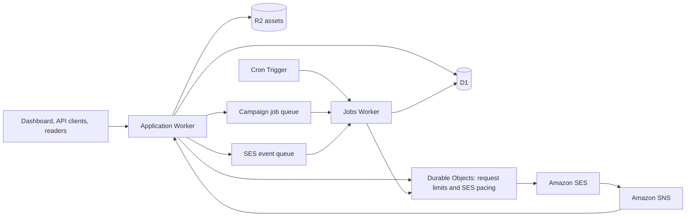

# Cloudflare setup plan with Alchemy

Prepared 14 October 2026 from the repository and current provider documentation. This plan targets new installations starting with empty databases and asset stores. No infrastructure or application behavior has been changed.

Replace the project's hosting, database, jobs, uploads, rate limits, and deployment dependencies with Cloudflare services, provisioned through Alchemy. Keep Amazon SES and, as approved, Amazon SNS solely for transporting SES events. Preserve the dashboard, APIs, archives, tracking, confirmation, unsubscribe, cleanup, and deliverability protections.

Starting from zero removes production data/asset transfers, old-hostname compatibility, historical email-link preservation, dual-provider operation, and a live cutover. Rewriting the existing Mongoose queries and implementing safe queue retries remain necessary because they are application code, even with an empty database.

## Service inventory and destination

The README describes the current deployment requirements; `package.json` and the integration code confirm the dependencies. Alchemy will create the Cloudflare resources and their bindings from a versioned stack definition, so each new install follows the same setup.

| Current service / function | Cloudflare destination | Repository scope |
| --- | --- | --- |
| Vercel or another Node.js host; Next.js 16.3.8 | Workers with static assets and a compatible Next.js deployment toolchain | `package.json`, `next.config.mjs`, `proxy.js`, `instrumentation.js`, all server routes/actions |
| MongoDB through Mongoose | D1 | Eight models, `lib/db.js`, and all query callers; this is a database rewrite, not a connection-string change |
| Upstash QStash campaign delivery | Queues and a jobs Worker | `lib/sending.js`, `lib/qstash-route.js`, both `app/api/jobs/` handlers |
| QStash delayed campaign jobs | Cron Triggers reading D1 schedules, then Queues | `lib/scheduling.js`, campaign scheduling actions |
| Optional Upstash Redis shared rate limits | Durable Objects | `lib/rate-limit.js` and existing callers |
| Optional Vercel Blob image uploads | R2 on an owned asset domain | `lib/blob.js`, uploads route, thumbnail rules, image configuration, stored content |
| Vercel domains, HTTPS, and deployment | Alchemy-managed Cloudflare Worker domains/routes and deployment | `APP_URL`, `ARCHIVE_HOSTS`, `alchemy.run.ts`, package scripts, deployment instructions |
| Next.js archive cache and image resizing | Alchemy's selected frontend cache integration, including managed KV; Cloudflare Images only if resizing is retained | Archive revalidation, `next/image` components, share-image route |
| Hosting logs and configuration | Workers Logs, Worker secrets and bindings | Configuration, activity notices, job/webhook diagnostics |
| Manual service creation and environment wiring | Alchemy stack, stages, and Cloudflare-backed deployment state | `alchemy.run.ts`, `.gitignore`, setup documentation |
| Google favicon resolver and Gravatar decoration | Bundled icons and existing initials/fallback avatars | `lib/favicon.js`, `ImageFavicon.jsx`, `ImageDomainLogo.jsx`, `AvatarContact.jsx` |
| Amazon SES sending, identities, quotas, alerts | Keep SES | `lib/ses.js`; retain configuration set, IAM permissions, DKIM, SPF, MAIL FROM, DMARC |
| Amazon SNS SES notifications | Keep SNS → Cloudflare HTTPS ingress → event queue | `lib/sns.js`, SES webhook, `lib/ses-events.js` |

The last two AWS rows are the agreed exception. SES configuration-set event destinations do not include a generic HTTPS webhook, so Queues cannot directly replace SNS while preserving the current event stream. [AWS event destinations](https://docs.aws.amazon.com/ses/latest/APIReference-V2/API_EventDestination.html).

User-supplied links and externally hosted images inside newsletter content are content, not required backend services. Do not silently copy or rewrite unrelated third-party content.

## Target architecture

Use two application Workers: an application Worker for the dashboard, APIs, public pages, and verified SES ingress; a jobs Worker for queue consumers, scheduled dispatch, and Durable Objects. Share the D1 binding and use private service bindings for internal calls. Keep public assets separate from private operational backups. Alchemy's remote deployment state adds its own supporting Cloudflare resources.

Start with one empty D1 database for this single-admin application, subject to the size and load gate below. Keep current pure helpers and business rules. Add SQL queries where needed; do not build a Mongoose emulation layer or add an ORM solely for this change. Keep KV limited to the frontend cache; request limits and send coordination remain in Durable Objects. No Workflows, containerized database, or new authentication provider is needed.

## Alchemy's role in a fresh installation

Use a root `alchemy.run.ts` as the source of truth for Cloudflare infrastructure. Pin the Alchemy/toolchain versions and use documentation for that version; do not mix the legacy v1 API with the current API.

- Declare both Workers, D1 with its SQL migration directory, the R2 asset bucket, campaign/event queues and their dead-letter queues, consumer configuration, Cron Trigger, Durable Object namespaces, private service bindings, secrets, and configured domains/routes.
- Use Alchemy's frontend resource for the selected runtime: pilot `Cloudflare.Website.Vinext`, with `Cloudflare.Website.Nextjs`/OpenNext as the compatibility fallback. Vinext's integration provisions KV-backed ISR; enable writable ISR explicitly if OpenNext is selected. Do not maintain a parallel hand-written Wrangler resource inventory. [Vinext integration](https://alchemy.run/cloudflare/frontend/vinext/), [Next.js integration](https://alchemy.run/cloudflare/frontend/nextjs/).
- Keep application handlers in JavaScript using native bindings and async functions. Alchemy supports plain async Workers; adding Alchemy does not require rewriting the application into Effect or TypeScript. The infrastructure definition can use the required TypeScript/Effect API. [Worker integration](https://alchemy.run/cloudflare/compute/workers/).
- Apply ordered SQL schema migrations through the D1 resource on deployment. New installs start with empty tables; no MongoDB export/import tool is needed. Ensure schema creation precedes any build-time prerendering that queries D1. [D1 migrations](https://alchemy.run/cloudflare/data/d1/).
- Use separate local, `staging`, and `prod` stages with their own resources, domains, and secrets. Local development must use the local stage, never `alchemy dev --stage prod`, which can replace that live stage. [Stages](https://alchemy.run/environments/stages/).
- Use `Cloudflare.state()` for shared deployment state in Cloudflare. Document its one-time state-store Worker/Durable Object/secrets bootstrap: even the first `plan` or `dev` can request creation of these resources, so do not describe those commands as universally read-only. Ignore `.alchemy/` and keep credentials/secrets out of Git. [State store](https://alchemy.run/state-store/).
- Explicitly retain production D1/R2 data on resource removal, keep logical IDs stable, and document how to recover deployment state. Destroying a disposable test stage must not remove production data.

Alchemy supplies provisioning, binding wiring, local emulation, frontend deployment, and schema deployment. SES production access, sending-domain verification, and the SNS event destination remain AWS setup prerequisites; include those instructions beside the simplified Cloudflare setup.

## Phase 1 — Establish runtime compatibility and the Alchemy stack

1. Define expected list sizes, monthly sends, peak tracking/signup traffic, and owned app/archive/asset domains. Use representative synthetic data to measure D1 growth and write load; there is no production inventory to transfer.
2. Restore dependencies with the existing lockfile. Before implementation, read the relevant installed Next.js guides under `node_modules/next/dist/docs/`, as required by `AGENTS.md`. That directory is absent in this checkout, so runtime compatibility has not been verified.
3. Pilot the Alchemy frontend integration against this Next.js 16.3.8 codebase. Current Cloudflare guidance recommends vinext, but labels it beta. Start with its compatibility check and an isolated preview; retain the original Next.js scripts until parity passes. Gate on Server Actions, `proxy.js`, cookies, `after()`, security headers, ISR/revalidation, `next/image`, and `next/og`. [Current Next.js deployment guide](https://developers.cloudflare.com/workers/framework-guides/web-apps/nextjs/).
4. If that pilot fails, evaluate OpenNext with the existing Next.js build. Its documented lack of Node.js middleware support is relevant to this project's Next.js 16 proxy: prove an equivalent supported auth/host-routing implementation before choosing it. Do not assume renaming `proxy.js` alone fixes it. [OpenNext support](https://developers.cloudflare.com/workers/framework-guides/web-apps/opennext/).
5. Add the Alchemy stack and local/deployment package scripts. Declare the compatibility date, Node compatibility flags, stage-specific bindings, and Worker secrets there. Staging starts with sending disabled and only uses designated test recipients when enabled. Do not seed a default admin password or commit generated credentials.
6. Adapt share-card font/local-logo loading to bundled assets or an asset binding. The current `process.cwd()` filesystem paths are not a deployed Node checkout; Workers' filesystem exposes bundled modules in a virtual filesystem. Verify PNG generation and existing WebP fallback. [Workers filesystem](https://developers.cloudflare.com/workers/runtime-apis/nodejs/fs/).

**Exit:** an Alchemy-managed staging preview passes auth, host routing, Server Action, cache, and share-image smoke checks using empty states or test fixtures. Record the selected toolchain and pinned versions before the wider rewrite.

## Phase 2 — Replace MongoDB with D1

This is the largest workstream. The repository has eight schemas and 40 files matching Mongoose/model/database imports, plus query-building helpers and their tests.

1. Write versioned SQL migrations for `newsletters`, `contacts`, `campaigns`, `messages`, `events`, `suppressions`, and `api_keys`, plus the existing alert-cooldown records. Add a small job outbox for reliable queue publication.
2. Keep 24-character hexadecimal text primary keys for new records to reuse existing ID validators and token helpers. Preserve API response shapes, routes, signed-token payloads, API-key hashing, slugs, and message tags. Generate a new strong `SESSION_SECRET` once for each install and retain it for that install's future email links.
3. Translate schema defaults, enum/range checks, normalization, timestamps, null/missing behavior, and unique indexes. Preserve contact uniqueness per newsletter, global suppression uniqueness, partial campaign/last-chance message uniqueness, archive-slug uniqueness, API-key hashes, and alert cooldowns. Use parameterized statements and explicit foreign-key/deletion behavior matching existing actions.
4. Translate CRUD, upserts, conditional state changes, imports, audience queries, joins, and aggregation pipelines. Scope includes:
   - `lib/contacts.js`, `lib/contact-import.js`, `lib/api-keys.js`, `lib/alerts.js`;
   - `lib/sending.js`, `lib/scheduling.js`, `lib/ses-events.js`, cleanup and audience helpers;
   - `lib/archive-data.js`, `lib/archive-slugs.js`, `lib/campaign-queries.js`, `lib/overview-data.js`, cleanup totals;
   - all dashboard pages/actions, signup/confirmation/keep/unsubscribe paths, tracking routes, views, public API routes, and issue routes.
5. Use SQL joins/`NOT EXISTS` for suppressions instead of loading the entire suppression list into memory. Replace Mongo cursors with bounded keyset pages while preserving engagement order and tie-breaking. Large audience preparation and CSV imports must use bounded work that fits Worker/D1 limits.
6. Preserve timezone-aware history and hourly charts, including DST and imported-contact semantics. SQLite's date functions are not a replacement for MongoDB's named-timezone aggregation; reuse the project's timezone helpers to calculate boundaries and bucket bounded query results correctly.
7. Make first-event transitions and related message/contact/campaign counters atomic, using conditional SQL plus a supported transactional batch or SQL triggers. A retry must not lose a counter after marking its first-event timestamp. Preserve complaint precedence and never reactivate bounced/complaining contacts.
8. Verify the Alchemy deploy creates all tables/indexes from an empty database and a second deploy does not repeat schema migrations or reset data. Add representative synthetic fixtures for statuses, counters, nested settings, imports, and report histories. Keep CSV contact import as an application feature; no provider-to-provider data-transfer tooling is in scope.

D1 currently caps a paid database at 10 GB, bound parameters at 100 per statement, and a row/string/blob at 2 MB. Chunk CSV imports and `IN` lists by actual parameter count; the current MongoDB chunk size of 1,000 is not portable. Measure throughput because each database serializes queries. If projected data or the workload does not fit, revise partitioning/retention before launch rather than silently discarding history. [D1 limits](https://developers.cloudflare.com/d1/platform/limits/).

**Exit:** empty-state behavior and synthetic contacts, campaign reports, archives, APIs, CSV imports, cleanup, and historical charts work in staging, with indexes and atomic-transition tests passing.

## Phase 3 — Replace QStash and Redis

1. Publish campaign/preparation jobs through a Queue binding. Keep current batch size initially, then tune using measured CPU, D1 calls, and SES latency. Store job intent in the D1 outbox alongside the state change; a dispatcher publishes and recovers interrupted publications. Duplicate publication must be harmless.
2. Run native queue consumers in the jobs Worker, reuse send validation and pause rules, and remove QStash's publicly callable job routes and signature wrapper. HTTP `maxDuration = 300` is not the Worker execution budget. Declare bounded consumer work, explicit retry configuration, and dead-letter queues in Alchemy; implement acknowledgments in the consumers.
3. Preserve conditional claims before calling SES. Queues deliver at least once and do not preserve order; uniqueness alone does not prevent two consumers sending the same record. Retain an atomic single-winner claim and do not blindly resend a message after an ambiguous SES/network result. The current pre-send claim can lose a send after a crash; expose ambiguous attempts for reconciliation instead of promising exactly-once delivery. Review AWS SDK send retry behavior as part of this boundary. [Queue guarantees](https://developers.cloudflare.com/queues/reference/delivery-guarantees/), [queue ordering](https://developers.cloudflare.com/queues/reference/how-queues-works/).
4. Replace per-instance pacing with one Durable Object coordinator per SES account/region, used by campaign, welcome, confirmation, test, and alert sends. Keep the configured cap below the actual SES account limit. Preserve pause/cancel checks and delivery-health thresholds; queued work must recheck current contact/suppression state just before sending. Issue jobs precede cleanup jobs for each campaign even when queue delivery is reordered.
5. Replace delayed QStash wakeups with a minute Cron Trigger querying indexed `scheduledAt` state in D1. Enqueue due campaigns through an atomic outbox entry keyed by campaign and schedule version. Retain stale-job guards for rescheduling/canceling, and recover missed runs on the next tick. Target approximately minute-level dispatch, subject to queue backlog; do not claim exact-time execution. Cron avoids the Queue delay ceiling of 24 hours. [Queue delays](https://developers.cloudflare.com/queues/configuration/batching-retries/), [Cron Triggers](https://developers.cloudflare.com/workers/configuration/cron-triggers/).
6. Replace Redis-backed `isRateLimited()` internals with Durable Objects keyed by limiter name/key, preserving the current windows and outcomes. The native Worker rate-limit binding is local/eventually consistent and only accepts 10/60-second windows, so it does not reproduce the existing 10-minute, 15-minute, and hourly policies. Bound stored hits and expire them; retain the documented fallback and outage alerts. [Worker rate limits](https://developers.cloudflare.com/workers/runtime-apis/bindings/rate-limit/).
7. Read trusted Cloudflare IP/country metadata at ingress rather than Vercel headers or an untrusted forwarded-IP header. Preserve explicit visitor-IP handling for authenticated contact API clients. Ensure the kill switch stops sending across both Workers and the SES coordinator, including already queued jobs.

**Exit:** concurrent campaigns plus signup/test/alert sends stay within the shared cap; duplicate jobs, publication crashes, throttling, pause/resume, scheduling changes, limiter restarts, and dead-letter replay behave safely.

## Phase 4 — Configure assets, SES ingestion, and operations

1. Implement `putImage()` with the R2 binding, immutable random object keys, correct content types, and current long cache lifetimes. Keep upload authentication, the 4 MB bound, and magic-byte validation. Return an HTTPS URL on an owned asset domain. Use a public asset bucket and a separate private backup bucket. [R2 public domains](https://developers.cloudflare.com/r2/buckets/public-buckets/).
2. Use the R2 asset domain for every new upload, newsletter/author image, and thumbnail. Update `next.config.mjs`, `isOptimizableImage()`, and affected image components/tests. Preserve resizing via Cloudflare Images if required; otherwise explicitly verify original-image delivery and dimensions. There are no existing Blob objects or historical image URLs to copy or retain.
3. Set stable app/archive/asset domains before the first real email so future links remain under the install owner's control. Configure them through Alchemy and document any domain-zone prerequisites.
4. Keep SNS topic allowlisting, certificate-host/path checks, signature verification, and subscription confirmation. After validation, durably enqueue SES notifications and only acknowledge after enqueue succeeds; retryable publication failures return non-2xx. Consumers reuse the event mapping and D1 suppression/first-event transitions. Test events arriving before the SES message ID is saved and repeated/out-of-order deliveries.
5. Configure `APP_URL` and `ARCHIVE_HOSTS` explicitly, preserve archive-origin isolation, security headers, session checks on every server action, and signed-link behavior. Set up owned domains/DNS and keep SES mail authentication records DNS-only where applicable. Automated webhook/tracking/unsubscribe endpoints must remain reachable without browser challenges.
6. Replace decorative Google/Gravatar requests with bundled icons/current fallback avatars to remove those application dependencies. Keep fonts in the build/assets; confirm `next/font/google` does not create a runtime dependency, and use existing licensed font files where supported.
7. Use the same Alchemy deployment script locally and in CI, with the lockfile, explicit stage, and selected toolchain; avoid a second deployment system with competing resource ownership. Enable logs, monitor queue backlog/dead letters, event lag, D1 failures, and SES throttling, and retain SES email alerts with atomic cooldowns. Test D1 recovery and private backup restoration with test data before launch. Do not log credentials or raw contact lists.

**Exit:** assets, share cards, domain routing, alerts, SES event processing, and a restore rehearsal pass in staging, with all resources defined through Alchemy.

## Phase 5 — Document and verify setup from zero

The resulting README should make a new install follow this sequence:

1. Clone the repository and install locked dependencies. Provide the supported Node/package-manager versions; retain npm support rather than requiring a switch to Bun solely for Alchemy.
2. Authenticate Alchemy to Cloudflare and choose the account/profile. Complete the documented one-time remote-state bootstrap. No separate manual D1, R2, Queue, or Durable Object creation should be required. [Cloudflare authentication](https://alchemy.run/cloudflare/setup/).
3. Set the small install-specific configuration: admin email/password, a generated session secret, SES credentials/region/configuration set/SNS topic ARN, and app/archive/asset domains. Keep resource IDs and binding names generated/wired by the stack. Sending defaults to disabled.
4. Run the local development script backed by `alchemy dev`, with emulated Cloudflare resources and no outbound emails by default. The existing admin login and empty-state UI should work without MongoDB, QStash, Redis, or Blob credentials. [Local development](https://alchemy.run/environments/local-development/).
5. Run one documented production deployment command, planned as `npm run deploy -- --stage prod`. It should invoke `alchemy deploy`, provision resources, apply D1 schema migrations, deploy both Workers/assets, configure bindings/triggers/routes, and print the app and SES webhook URLs. Document build/schema ordering and any account/domain activation requirements.
6. Finish SES production access, verified sending domain/DKIM/MAIL FROM/DMARC, IAM permissions, and configuration-set events to SNS. Subscribe SNS to the printed HTTPS webhook and verify subscription confirmation and test feedback. These are the retained AWS prerequisites, not Cloudflare resources.
7. Log in, create the first newsletter, send a designated test, and verify delivery, unsubscribe, and bounce handling. Enable sending explicitly through the documented configuration/deploy flow only after feedback works.
8. Repeat deployment to prove it reuses resources without clearing contacts/assets or reapplying schema migrations. Also rehearse a second independent installation in a separate test stage to prove setup does not depend on cached resource IDs or another install's secrets.

Remove Mongoose, QStash, Upstash Redis/ratelimit, and Vercel Blob packages and variables when their callers are gone. Update `README.md`, `.env.example`, `SECURITY.md`, `.gitignore`, package scripts/lockfile, fixtures, and setup instructions. Keep SES/SNS settings; replace former service credentials with Cloudflare bindings. Infrastructure-only TypeScript must coexist with the current JavaScript app and lint setup.

**Recovery:** once an install starts sending, keep D1 and opt-outs/suppressions authoritative. Disable sending before recovering failed jobs or incompatible code; roll back only to Worker code compatible with the current schema, using backward-compatible schema changes where needed. Restore backups deliberately and never reset sent/ambiguous messages to queued blindly. No reverse migration to MongoDB is needed for this fresh-install scope.

## Validation and completion criteria

Retain the existing Node unit suite and lint checks. Update Mongo query-shape fixtures to test the resulting behavior, and add small real-binding integration checks for atomic SQL transitions, outbox recovery, queue redelivery, shared rate limits, and empty-database schema deployment. Run Alchemy local previews and deployed staging checks: passing Node tests alone does not establish deployment compatibility. Request elevated permission for test execution outside the sandbox, as instructed by the user.

Validate signup/confirmed opt-in, welcome/test/last-chance email behavior, CSV imports, campaign scheduling/rescheduling/canceling, send-to-more, suppression precedence, bounce/complaint pause thresholds, scanner filtering, stats/timezones, API-key revocation, auth/archive isolation, public URLs, image uploads, and cache refresh after edits/sends. Use existing token fixtures to preserve signed-link behavior. Verify deploy-twice idempotency and fresh setup in an independent stage.

Completion means a new user can install, configure, and deploy the application through Alchemy without creating Cloudflare services individually; all application reads/writes/jobs use Cloudflare; no MongoDB, QStash, Redis, or Blob credentials/calls remain; and SES/SNS feedback protects deliverability. A second deploy retains data and a separate install starts cleanly.

Budget for Workers Paid plus measured D1, R2, Queue, Durable Object, frontend KV cache, and optional Images usage; keep SES/SNS costs separate. Workers' published base subscription is currently $5/month, not the total application bill. Estimate from expected sends, database operations/index writes, tracking traffic, assets, retries, the two application Workers, and Alchemy's supporting state resources before committing to a monthly total. [Workers pricing](https://developers.cloudflare.com/workers/platform/pricing/), [Queues pricing](https://developers.cloudflare.com/queues/platform/pricing/).

The critical path is Alchemy/runtime compatibility → D1 behavior → job/suppression safety → independent fresh-install rehearsal → launch. Asset configuration can proceed independently once the stack and domains are defined. No firm duration or total cost is justified until the workload assumptions and runtime pilot are verified.

Skipped intentionally: production transfers, legacy URL support, temporary cutover queues, and reverse database migration. Not checked: builds, tests, Alchemy deployment, or live account setup. Main risks: runtime compatibility, the D1 query rewrite, and ambiguous email sends during failures.
